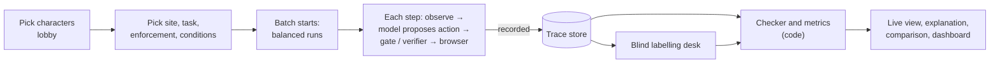
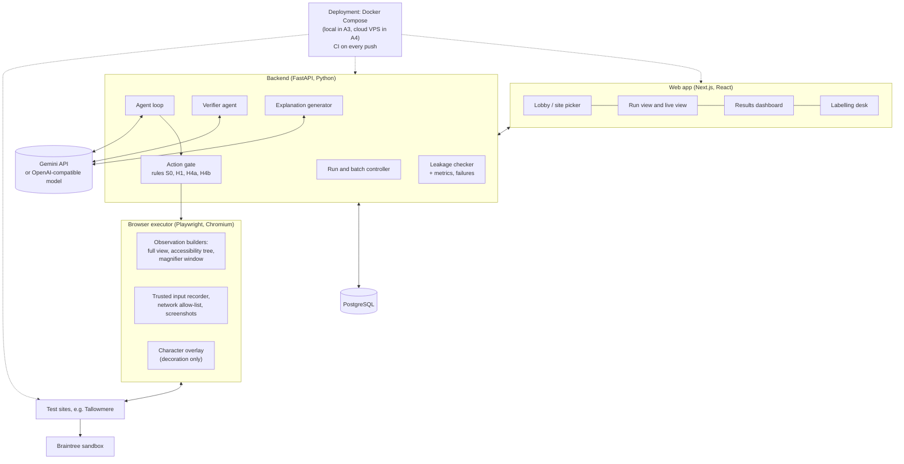

# Vanguard: Auditing LLM-Simulated Users with Enforced Limits

**Project track: Pure Product**

| Item | Details |
|---|---|
| Product name | Vanguard |
| One-line description | Runs AI "simulated users" with stated limits (for example a keyboard-only shopper) through real websites, enforces and checks those limits in code, and reports where the simulation broke them |
| Project track | Pure Product |
| Group members | Faateh Haneef (23i-0688), Abdul Hadi (23i-0676), Ibrahim Malik (23i-0694) |
| Course | AI-4009 Generative AI, FAST-NUCES Islamabad, Section A |
| Repository | https://github.com/FaatehHaneef/Vanguard |

## 1. Title and Team

The proposed product is **Vanguard**, a tool that audits AI agents used as stand-ins for real users. The project follows the Pure Product track: the aim is a complete, reliable, deployed product, not a research result. Design choices are still justified by comparing alternatives for the main AI tasks (Section 6). The team has three members, whose roles are given in Section 12; every member works on both AI and engineering parts.

## 2. Problem and Motivation

Product teams increasingly try AI agents as early, cheap stand-ins for real users: an agent told to behave like "a shopper who only uses a keyboard" or "a blind shopper using a screen reader" is sent through a website to find problems before anyone is recruited for testing. Persona-driven usability agents [4] and agents that use a screen-reader proxy to find accessibility faults in apps [5] are examples of this direction.

Such simulations are only useful if the agent actually stays within the limits it was given, and in practice it often does not. An agent told it cannot use a mouse may still "click"; an agent told it is blind may still describe colours or positions it could not perceive; an agent playing a first-time visitor may type a product code it could never have seen. We call this **leakage**. Published work reports the same tendency for vision: "VLMs tend to infer beyond the specified vision ability when given minimal prompts" [2]. Public data shows how far apart the behaviours are. In the Reduced A11y-CUA logs [1], by our count, blind and low-vision users made 0.1% of their actions with a pointer and 58.4% of their key presses were Tab or arrow keys, against 60.8% pointer actions for sighted users; the two computer-use agents in the dataset used the pointer for 15.0% (Claude Sonnet 4.5) and 89.2% (Qwen3-VL-32B) of their actions under a magnifier condition (`docs/results/a11y-cua-reference.md`; desktop tasks, not web shopping). A related problem is **collapse**: supposedly different personas behaving alike [3]; in the team's earlier project, Gemini given ten different personas named only 9 distinct games across 178 answers.

Today this is handled by writing the limits into the prompt and hoping, or by reading transcripts by hand. Neither scales, and neither produces evidence. Vanguard addresses the gap with three things that existing tools do not combine: limits written as a structured specification; enforcement of those limits in code at the point where the agent acts (and, as alternatives, through what the agent may perceive and through a second checking model); and a deterministic audit that reports, step by step, where a simulation broke its limits.

Generative AI is needed for the simulated user itself: it must read unstructured, changing web pages and choose its next action, which is what tool-calling language models do. Everything that must be exact (whether a step leaked, counts, rates, scores, payment safety) is deterministic code; no model counts, scores or checks a rule.

**Positioning.** Vanguard is early pre-testing. It does **not** replace testing with disabled people and does not claim to simulate them. Reports state this limit.

| Existing approach | What it does | What it lacks for this problem |
|---|---|---|
| Prompt-only persona agents (e.g. [4]) | Describe the persona and its limits in the prompt | No enforcement, no step-level evidence of whether the limits held |
| Screen-reader-proxy agents (e.g. [5]) | Give the agent a screen-reader-like interface for one modality | Specific to one modality and one platform; no general limit specification or leakage audit |
| Automated accessibility checkers (axe, Lighthouse) | Rule checks on page markup | No task-level behaviour; cannot tell whether a keyboard user can actually complete a purchase |
| **Vanguard** | Limits as a spec, enforced in code, every step audited, enforcement methods compared on the same tasks | Not a substitute for real users (stated limit) |

## 3. Product Overview and Features

From the user's view, Vanguard is a web app with a game-like front end. The user picks a party of characters, each a persona (Knock: keyboard-only; Echo: screen-reader user; Iris: magnifier user; Wren: first-time visitor; Cog: an unrestricted control agent), picks a site and a task, chooses how the limits are kept, and starts a trial. Each character then shops on the real site in a real browser; the user watches a live view with the character walking to each element it acts on, and afterwards sees a step-by-step trace, a plain-language explanation, the checker's findings, and a comparison table across characters and enforcement methods.

**Core features (must have):**
1. Persona specifications built from limits L1–L4 (no pointer; accessibility tree only; magnified view; first-time-visitor knowledge), stored as validated JSON.
2. A simulated-user agent driving Chromium from outside the page through tool calls, with real key presses and clicks.
3. Enforcement options: prompt-only (baseline), a code-enforced action gate, bounded perception, and a verifier agent.
4. A deterministic leakage checker sharing its rules with the gate, plus browser evidence (trusted input events) and planted honeytokens.
5. Metrics per run and per group: executed and attempted leakage, success, steps, stuck rate, latency, tokens and cost, with 95% intervals.
6. Balanced, resumable batches of repeated runs; live view; results dashboard; blind labelling desk with inter-rater agreement.
7. Safety: the browser can reach only allowed origins and the payment provider's sandbox hosts.

**Further features (implemented in A3):**
8. **Configuration studio**: create, edit and save personas from limits L1–L4, add any website by its address, and define tasks with a success check, without changing code. Custom items join the built-in catalogue at once; their origins are allowed automatically.
9. **Live view and replay**: the test browser is streamed to the run page while a run goes, with the character overlay inside the page; any finished run can be replayed step by step, showing the screen, what the persona perceived, what it proposed and why, the gate and verifier decisions with rule and message, the page result, and the checker's findings.
10. **Findings report and failure attribution**: usability problems found by code (inaccessible controls, navigation failures, repeated actions, confusing workflows, failed tasks), and for every failed run whether the site, the persona's restriction or the agent itself is the cause, judged against the control agent's runs and the site manifest. Every report carries the limits statement.
11. **Comparison report**: two batches side by side, group by group, with each metric marked better, worse or same, plus the failure causes that are new or resolved; used to compare methods, models or website versions.
12. **Several actions per model call**: the model may return up to four actions at once, each still gated and recorded as its own step; this cut model calls per run by about half.
13. **Eight test sites** in different frameworks and domains (shop, clinic, library, council, restaurant, tickets, news, recipes), each with planted barriers and honeytokens, checked by one command.

**Extended features (A4):** testing an owner's own site after a verification snippet; PDF and email reports; a fine-tuned local model as a further enforcement option.

**End-to-end workflow.**

## 4. System Components and Architecture

| Component | Technology | AI or deterministic |
|---|---|---|
| Simulated user (agent loop) | Gemini with forced function calling; up to four tool calls per model call, each gated and recorded as its own step | **AI** |
| Findings and failure attribution, comparison report | Python, recomputed from the store | Deterministic |
| Configuration studio | FastAPI routes and Next.js editors; validated by the shared contracts | Deterministic |
| Live view | Chrome screencast frames served by the API | Deterministic |
| Verifier agent (option 4) | Second model call, JSON output | **AI** |
| Explanation generator | Model writes text from facts computed by code; template fallback | **AI** (wording only) |
| Observation builders | Playwright, in-page scripts, Chrome accessibility tree | Deterministic |
| Action gate, leakage checker, metrics, failure grouping | Python rules shared by gate and checker | Deterministic |
| Batches, store, API | FastAPI, SQLAlchemy, PostgreSQL | Deterministic |
| Web app | Next.js, React, Tailwind | Deterministic |
| Test site Tallowmere | Next.js shop, Braintree sandbox checkout | Deterministic (external integration) |

**Implementation framework.** Backend: Python 3.11, FastAPI, Pydantic contracts, SQLAlchemy, Playwright (Chromium). Models: Gemini through the `google-genai` SDK with forced function calling, or any OpenAI-compatible endpoint (Ollama, LM Studio, Groq). Web app: Next.js 16, React 19, Tailwind. Test sites: Next.js, plain HTML, Vue 3, Flask, React, SvelteKit, Astro and Django. Deployment uses Docker Compose: the database, the API with the Playwright worker, the web app, and one service per test site (each site's own `compose.yml` is included). Continuous integration runs linting, the backend tests (including tests in a real Chromium), the web and site builds, and the Compose build on every push.

### 4.1 Database Design

PostgreSQL in deployment, SQLite for local runs, through the same SQLAlchemy models. A step's full record is stored as JSON, validated against the shared contract on read, so the audit can always be recomputed from the store.

| Table | Key | Holds |
|---|---|---|
| `runs` | run id | configuration (persona, site, task, enforcement, provider, seed, actions per call), batch id, status, outcome, step and refusal counts, times, error |
| `steps` | run id + step index | the full step record: observation (mode, URL, perceived text, links, magnifier window, screenshot path), proposed action and rationale, model call number and position in the call, gate and verifier decisions, input events, URL and focus after, target box, latency, tokens, cost |
| `batches` | batch id | the batch request (tasks × personas × methods, repeats, call budget), so progress can be reported and resumed |
| `labels` | run id + step + labeller | one person's verdict on one step (violation or not, limit, kind, note) |
| `label_samples` | bundle | the fixed, seeded sample of steps in a labelling bundle |
| `custom_personas`, `custom_sites`, `custom_tasks` | id | items made in the configuration studio, validated against the same contracts as the built-in catalogue |

Leakage verdicts, metrics, findings and comparisons are not stored: they are recomputed by code from `runs` and `steps`, so a rule change never leaves stale results. Screenshots and live-view frames are files under the data directory, outside the database and the repository.

## 5. Generative AI Techniques

| Technique (A3 Table 4) | Where it is used | Why |
|---|---|---|
| Foundation model API, function calling | The simulated user chooses each browser action as one forced tool call from a typed tool vocabulary | Actions must be machine-checkable: the gate and checker read the tool name and arguments, not free text |
| **Agents and tool use** (the required agentic component) | Observe → propose → gate → execute loop with keyboard, pointer, screen-reader, magnifier, navigation and control tools | The task is multi-step interaction with live pages |
| Structured output and reliability | Pydantic-validated actions, verifier decisions and explanations; schema-invalid replies recorded as model failures; key and model fallback | Reliability and measurable failure rates |
| Prompt engineering | Versioned system and step prompts (persona, task, short history, current perception); prompt-injection rule for page text | Reproducibility; logged with every run |
| Open-source / local models | OpenAI-compatible provider (Ollama, LM Studio, Groq) in local runs | Model alternative (Section 6) |
| Integrations | Braintree sandbox checkout driven by the agent; PostgreSQL | Required external integration |
| Evaluation and observability | Labelled test set, kappa, per-step traces with latency, tokens and cost | Quantitative evaluation from the start |

Candidate models: Gemini Flash (every A3 result uses `gemini-3.6-flash` on the free tier; `gemini-3.8-flash` is the current paid model for deployment) and Gemini Flash-Lite as a cheaper tier; local open models (for example Qwen family through Ollama) for the model comparison; a LoRA fine-tune of a small open model is a stretch goal for A4.

## 6. Technical Alternatives

**AI task 1: keeping the simulated user within its limits (the core comparison).** Four options run on identical tasks with repeated runs:
1. *Prompt-only* (baseline): limits are described in the prompt only.
2. *Code-enforced gate*: forbidden actions are refused before they reach the browser, and the agent is told why.
3. *Bounded perception*: the agent only receives what its user could perceive (accessibility tree for the screen-reader persona, a 400% magnifier window for the low-vision persona).
4. *Verifier agent*: a second model call checks each proposed action against the persona before it runs.

Options can be combined. The choice is made on executed and attempted leakage, task success, steps, stuck rate, latency and cost, with 95% intervals.

### 6.1 Limits, personas and how each is checked

The three kinds of limit need different detection, so each has its own method:

| Kind | Limits | Detected by | Evidence |
|---|---|---|---|
| **Action** | L1 no pointer | The action itself (a pointer tool), and trusted pointer events recorded in the page | The gate refuses before execution; the checker confirms from the input events |
| **Perception** | L2 accessibility tree only; L3 magnified view | Whether the step used something the persona could not perceive: an element outside the magnified window, or a string shown only visually | Honeytokens: strings placed where only the forbidden channel reveals them (an `aria-hidden` batch code, a footer code far below the magnified view) |
| **Knowledge** | L4 first-time visitor | Navigation to an address never seen in an observation, or a site-specific term never seen yet | The set of links and text the persona has perceived so far; an unlinked staff page with a code |

Personas are bundles of these limits, evaluated separately because they cannot share one criterion:

| Persona | Limits | Can perceive | Can do | Expected behaviour | Evaluated on | Status |
|---|---|---|---|---|---|---|
| Knock, keyboard-only | L1 | The full page | Keys only (Tab, arrows, Enter, Space, typing) | Moves by focus; cannot use mouse-only controls; gives up or finds a keyboard route | Executed pointer actions (gate refusals, pointer events) | Full |
| Cog, unrestricted control | none | The full page | Everything | Reference behaviour on the same tasks; its "leaks" are a reference rate | Task success and steps (the yardstick) | Full |
| Echo, screen-reader user | L1, L2 | The accessibility tree only | Screen-reader and keyboard commands | Cannot know what is only drawn on screen | Honeytokens (H2b), uses of unnamed controls | Preview |
| Iris, magnifier user | L3 | A 400% window, moved by panning | Everything, within the view | Must pan to find content far from where the page opens | Elements outside the window (H3a), honeytokens (H3b) | Preview |
| Wren, first-time visitor | L4 | The full page | Everything | Knows nothing site-specific until it has seen it | Unseen addresses (H4a) and terms (H4b), honeytokens (H4c) | Preview |

As advised, A3 evaluates the two full personas end to end; the three preview personas run and are checked, but their results are marked "not validated" until their labelled sets are complete.

**How bounded perception keeps hidden information out.** The observation for each persona is built by the browser executor, not filtered from a full page afterwards. For Echo it is Chrome's accessibility tree (the same tree a screen reader reads), so text that is `aria-hidden` or drawn only in images or CSS never reaches the model, while text a real screen reader would announce (including visually off-screen text) does; element identifiers are the tree's own, not page coordinates. For Iris it is only the elements that intersect the magnified window, in document coordinates, with nothing outside it. Screenshots are never sent to the model. A test in a real Chromium plants an `aria-hidden` code, an off-screen code and a far-away footer code, and asserts that each persona's observation contains exactly what its user could perceive; honeytokens then catch any step that uses hidden information anyway (for example from the model's prior knowledge).

### 6.2 What each enforcement condition changes

| Condition | What changes | What stays fixed |
|---|---|---|
| Prompt-only | The limits are described in the prompt | Model, prompt version, tools offered, tasks, sites, step limit, seeds |
| Gate | As prompt-only, plus code refuses any action outside the limits before it reaches the page and tells the agent why | As above |
| Bounded perception | As prompt-only, plus the observation is built for the persona's perception | As above |
| Verifier | As prompt-only, plus a second model call judges each proposed action against the persona before it runs | As above |

The four address different things: the gate enforces action limits; bounded perception enforces perception limits; the verifier is a learned, general check that can cover all three but can be wrong. They are therefore compared on the same tasks, and each is also judged on the limits it is meant to cover.

**AI task 2: explaining a run.** (a) template only; (b) model text; (c) model text checked by code, rejected if it contains any number not in the computed facts or skips a finding. Chosen on correctness (human check of a sample), rejection rate and latency.

**AI task 3: the agent's model.** Gemini Flash vs Flash-Lite vs a local open model, on the same tasks; chosen on success, leakage and cost.

**AI task 4: the verifier itself** is measured against the hard rules (precision and recall of its refusals).

## 7. Data

- **Our own traces (main data).** Every step stores what the persona perceived, the proposed action and rationale, the gate and verifier decisions, browser input events, URL, focus, target box and timings. Sites are split before any run into train, dev and test groups; prompts are written against train and dev sites, and headline results and labels come from test sites only. Tallowmere was written by the team, so it is a dev site.
- **Labels.** Two members label sampled steps independently with a written guide, without seeing the checker's output (Section 8).
- **Public datasets (verified, stored outside the repository).** Reduced A11y-CUA [1] (CC BY 4.0; sessions of blind and low-vision users, sighted users and two agents under screen-reader and magnifier conditions), used for reference statistics only, never training; Mind2Web (CC BY 4.0, 1,009 tasks) for possible general web-navigation fine-tuning; a sample of WebWorldData (Apache 2.0). Data cards are in `docs/data-cards.md`.
- **Volume.** By submission: 114 recorded runs with 678 steps in the team's store, plus 24 task-suite runs; 60 labelled steps (bundle 1) and 60 more in labelling (bundle 2). A4 grows this to at least 100 labelled steps per evaluated persona.
- **Privacy.** Test sites are fictional with fake accounts; payments run in the sandbox only, enforced in code. A11y-CUA comes from a user study: only aggregate statistics are used and no individual session is quoted. No personal data from users of Vanguard is collected beyond their own runs.

## 8. Evaluation Plan

| Component | Test set | Metrics | Baseline |
|---|---|---|---|
| Simulated-user agent | Fixed task × persona × run set (A3: 24 runs on Tallowmere and Willowbrook, 2 tasks × 2 personas × 2 options × 3 repeats) | Task success, steps per task, tool-call validity, stuck rate, executed and attempted leakage per limit | Prompt-only vs gate (and later bounded perception, verifier) |
| Leakage checker (deterministic, validated against people) | 60 labelled steps in A3 (≥ 100 in A4), two labellers | Cohen's kappa between labellers (target ≥ 0.6); checker vs agreed labels: kappa, precision, recall | Labellers' agreement as the ceiling |
| Verifier agent | Same labelled steps | Precision and recall of refusals vs hard rules and labels | Gate (rules) |
| Explanation generator | ≥ 50 explanations | Rejection rate of the checked mode, factual errors in a human-checked sample | Template |
| Every AI component | All runs | Latency p50 and p95 per step, tokens and cost per run, model failure rate | — |

Error analysis groups every failing run by cause, computed by code (model unavailable, run error, persona leak, invalid output, refusal loop, action errors, stuck, step limit, gave up, wrong answer); at least ten failures are read and described with planned fixes. **First results (A3; full tables in `docs/results/a3-results.md`, regenerated by `backend/scripts/a3_results.py`).** Model gemini-3.6-flash; Tallowmere `cheapest` and Willowbrook `wb-callback`; 24 runs (3 per persona, task and option), 119 steps, 12-step cap.

| Keyboard-only persona | Success | Runs with an executed leak | Mean steps |
|---|---|---|---|
| Prompt-only | 6 of 6 | **5 of 6** (it clicked with a mouse; in the sixth run it answered without clicking) | 4.7 |
| Gate | 6 of 6 | **0 of 6** (4 attempted clicks refused, in 4 runs; it then finished by keyboard) | 6.5 |

The control persona leaked in every run under both options (its reference rate). Step latency p50 8.5 s and p95 26.6 s; about 1,900 input tokens per step; $0 on the free tier, about $0.008 per run at the paid list price. Labelled test set: 60 steps from the real runs labelled independently by two members; Cohen's kappa 1.00, and the checker matched the agreed labels with kappa 1.00, precision and recall 100%. Because this sample is dominated by unambiguous input-type cases, A4 adds harder information-leak cases (preview personas, honeytokens). Failure analysis over all 37 A3 runs with the real model: 15 failing runs, 8 stopped by model quota (planned fix: several actions per model call and local models for volume) and 7 keyboard-only runs that clicked under prompt-only (the leak the gate exists to stop). These first runs compared prompt-only and the gate; the four-method comparison in Section 8.2 then added bounded perception and the verifier. The explanation generator is integrated, and its evaluation on labelled explanations is planned for A4.

**Diversity measure** (as agreed in the approval feedback). For each persona and task across repeated runs, and between personas: the normalised edit distance between the sequences of action types; the Shannon entropy of the action-type mix; and the spread (standard deviation and interquartile range) of step counts and success. The input-modality profile is compared with the Reduced A11y-CUA reference statistics where the quantities match (for example, blind and low-vision users made 0.1% of their actions with a pointer and 58.4% of their key presses were Tab or arrow keys), noting that A11y-CUA tasks were desktop tasks rather than web shopping. The entropy and interval helpers are implemented; the diversity report itself is A4 work.

### 8.1 Task-level evaluation
Single labelled steps do not show whole failures, so tasks are also evaluated as tasks. Every task has a scenario (search, add to cart, checkout, form, recovery from an error, finding information) and a deterministic success check; the A3 task suite covers every scenario across the sites, and results are reported per scenario: completion, actions, model calls, repeated attempts, latency and cost (`python -m vanguard.evaluation task-report`). The design and results are in the evaluation section by Ibrahim Malik (Appendix A.1).

### 8.2 The four methods, and twin runs
Batch `four-methods-callback` (Willowbrook's call-back form, Knock and Cog, all four methods, 3 runs each; `docs/results/four-methods.md`):

| Knock (keyboard-only) | Success | Runs with an executed leak | Steps | Model calls per run |
|---|---|---|---|---|
| Prompt-only | 3 of 3 | 3 of 3 | 7.3 | 3.3 |
| Gate | 3 of 3 | **0 of 3** | 10.3 | 6.0 |
| Bounded perception | 3 of 3 | 3 of 3 | 7.7 | 4.0 |
| Verifier | 3 of 3 | 3 of 3 | 8.3 | 13.7 |

Only the gate stopped every leak, at no cost in task success and about three extra steps. Bounded perception does not address an action limit (it is meant for L2 and L3). The verifier was answering throughout but allowed 3 of Knock's 5 pointer actions, at about four times the model calls. The control agent behaved identically under all four.

Twin runs give the same persona the same task with its limits only described and with them enforced (`docs/results/twins-and-versions.md`). Iris, the magnifier persona, found the floor of a book in 5 steps in all three runs when she could see the whole page, and failed all three when her view was enforced (only a 400% window), repeating herself about six times per run: the planted barrier, information in a far-right sidebar, only bites when the perception limit is real, so a prompt-only simulation would have missed it. Knock could not finish Northgate's reservation within 12 steps under either condition (the control agent needs about 10); the gate changed how he failed, not whether: without it he used the mouse in 2 of 3 runs, with it never. The failure attribution reads these runs as restriction failures (Iris's because the same persona succeeds without enforcement; Knock's because the control succeeds and he did not reach the controls he wanted by keyboard in time), each marked as a candidate for people to check.

### 8.3 Realism
Enforcing a limit does not make behaviour realistic, so realism is measured separately: each persona's input profile (pointer share of actions, Tab and arrow share of key presses) is compared with the matching group of real users in the A11y-CUA data [1] (`python -m vanguard.evaluation realism`).

### 8.4 Diversity
Across repeated runs of one persona and task, and between personas: the normalised edit distance between action-type sequences (navigation paths), the Shannon entropy of the action-type mix (interaction strategy), and the spread of steps, success and failure causes (`python -m vanguard.evaluation diversity`).

### 8.5 The verifier against people
Two members label bundle 2 (60 steps, half of them refused or flagged steps, shown without the checker's verdicts) independently. The verifier's decisions are scored against the agreed labels: precision, recall and false-positive rate (`python -m vanguard.evaluation verifier-report`, tested on hand-made data), alongside the gate's. Bundle 2 was being labelled at submission; its results are shown at the demonstration. On the steps it judged in the four-method runs, the verifier allowed 3 of Knock's 5 pointer actions.

### 8.6 Website versions
Every test site was redesigned during A3 with its tasks, barriers and honeytokens unchanged; the earlier versions are kept (git tag `sites-v1`). Running the same persona, task and method on both versions and comparing them with the comparison report shows whether the redesign introduced new failures. For Knock under the gate on Willowbrook's call-back form, version 2 kept success at 3 of 3 and leaks at 0, and needed fewer steps (9.0 vs 10.3) and model calls (5.0 vs 6.0); the report found no new failure causes.

**Scope of the A3 evaluation, and what follows in A4.** The free tier allows about 20 model requests per key per day, so A3 uses **3 runs per persona, task and method** on short tasks with at most 12 steps, and several actions per model call. All four methods are compared in A3. A4 raises the repeats to 5, adds the longer tasks and the task-suite runs on the two newest sites, uses local models for volume, and grows the labelled set to at least 100 steps across all evaluated personas.

**User-level benefit.** For a site owner, the test is whether Vanguard finds the planted barriers that matter to each persona (for example the cart's quantity buttons that a keyboard user cannot reach) and explains them correctly.

## 9. Deployment Plan

Vanguard is deployed with Docker on a cloud VPS, not on a serverless host, because the worker needs a full browser. Docker Compose runs the database, API with the Playwright worker, web app and test sites; the same Compose file runs everything locally. Test sites are ordinary standalone websites and can also be deployed separately (for example on Vercel), in which case Vanguard's allowed origins are set to their public addresses. Secrets live in environment files that are never committed. Concretely, for A4: one cloud VPS with at least 4 GB of RAM (for example DigitalOcean or Hetzner) running the Compose stack behind HTTPS; the agent model through the Gemini API (Google-hosted); local open models through Ollama on a team laptop or Kaggle's free GPUs for bulk evaluation runs. For A3 the system runs reproducibly from the repository (`docker compose up`). Updates: every push runs CI (lint, tests in a real Chromium, builds); a release on the VPS is `git pull` followed by `docker compose up -d --build`, and the database is backed up before each release.

## 10. Funding and Business Model

**Target customers.** Small product and UX teams who want early accessibility and usability checks without a large research budget, and university HCI and accessibility researchers who run simulated-user studies and need evidence that their simulations stayed in character.

**Operating cost estimate (pilot).** Model use dominates. Gemini 3.8 Flash costs $0.75 per million input tokens and $3.75 per million output tokens through 31 December 2026, doubling on 1 January 2027, and has a free tier [7]. Measured in A3: about 1,900 input and 34 output tokens per step, so about $0.0016 per step; a typical 20-step task costs about $0.03. A pilot of 2,000 runs per month costs about $60 in model use (about $120 after the January price change), plus a VPS of roughly $20–40 per month. Local models remove the model cost for teams with their own hardware.

**Revenue model.** Freemium: free runs on the public test sites; paid plans per monthly run volume for testing one's own sites; an institutional licence for research groups and courses.

**Seed funding sources (researched 2026-11-22; to be re-checked before applying).**
- *National Incubation Center (NIC) Islamabad*, funded through the Ignite National Technology Fund. Cohort 6 accepted tech-enabled startups at idea, MVP or growth stage, solo founders or teams with at least one Pakistani national, with AI among the listed sectors; its window closed on 21 September 2026, and Cohort 7 dates are not yet announced [8]. Other centres (for example NIC Peshawar) were reported open in October 2026.
- *Google for Startups Cloud Program*, which offers cloud and Gemini credits in tiers for early and funded startups, with a larger tier for AI-first companies [9]. Credit amounts and eligibility were reported only by unofficial guides and must be confirmed on Google's official page.

**MVP.** One persona pair (keyboard-only and control), one test site, prompt-only vs gate, with the live view, checker report and comparison table: this exists today.

**Lean Canvas.**

| Problem | Solution | Unique value proposition | Unfair advantage | Customer segments |
|---|---|---|---|---|
| AI simulated users break their stated limits unseen; results cannot be trusted; manual transcript review does not scale | Limits as specs, enforced in code; every step audited; methods compared on the same tasks | Evidence, step by step, of whether a simulated user stayed in character, before acting on its findings | A shared rule core for enforcement and audit, planted honeytokens, and a test-site kit | Small product and UX teams; HCI and accessibility researchers; courses |
| **Key metrics** | runs per month, share of runs with executed leakage found, checker agreement with people | **Channels** | accessibility and HCI communities, university labs, demo tracks | |
| **Cost structure** | model tokens, VPS, maintenance of test sites | **Revenue streams** | freemium plans by run volume; institutional licence | |

## 11. Risks and Responsible AI

- **Over-claiming.** The biggest risk is that a simulated persona is mistaken for a real disabled person's experience. Every findings report carries this statement: "Simulated users cannot establish accessibility compliance, and they do not represent the experience of real people with disabilities. Findings marked as a barrier for a limit are candidates for evaluation by people; findings attributed to the agent are failures of the simulated user itself, not of the website."
- **Prompt injection from pages.** Page text is content, never instructions; the prompt says so, the gate limits what any action can do, and a set of injected pages is tested (Section 13).
- **Payments.** The browser can reach only allowed origins and sandbox payment hosts; this is enforced by the network filter and the gate, and tested.
- **Model failures and hallucination.** Invalid tool calls are recorded as model failures, never silently replaced. Explanations only word facts computed by code; the checked mode rejects text with numbers not in those facts.
- **Measurement validity.** The checker is validated against two human labellers; preview personas are marked "not validated" until their checks are complete.
- **Human approval.** Testing a site that the team does not own requires the owner's consent, given by installing a verification snippet (A4).
- **Security and secrets.** Keys stay in untracked environment files; the repository history is scanned before each push.

## 12. Work Plan and Team Roles

| Member | AI work | Engineering work |
|---|---|---|
| Faateh Haneef | Agent loop and prompts, enforcement options, the A3 comparison runs | Architecture, executor and worker, gate and rules, API, CI, deployment |
| Abdul Hadi | Explanation generator (alternative c), perception and prompts for the preview personas | Results and live-view polish; 2–4 test sites |
| Ibrahim Malik | Verifier evaluation, labelling and kappa, failure analysis | Leakage checker and metrics extensions, functional tests; 2–4 test sites |

In the second phase of A3 the work was divided by module: Faateh Haneef, the engine, live view and replay, findings and attribution, the four-method and twin runs, the site redesigns and the comparison API; Abdul Hadi, the configuration studio, the comparison page, two new sites and the verifier runs; Ibrahim Malik, the evaluation package (task suite, realism, diversity, verifier report, repeated attempts, calls vs actions) and two new sites. Every module was reviewed and merged by Faateh.

**A3 / A4 split.** About 70% of the product is implemented for A3:

| Area | A3 (implemented and evaluated) | A4 (remaining) |
|---|---|---|
| Agent and enforcement | Agent loop with several actions per call; all four methods; gate, checker, honeytokens | Fine-tuned local model as a fifth method |
| Personas | Two full personas evaluated; three preview personas running | Full checks and labels for the three preview personas |
| Product features | Lobby, live view, replay, findings and attribution, comparison report, configuration studio, labelling desk | Own-site testing with a verification snippet; PDF and email reports |
| Sites | Eight test sites, redesigned, with planted barriers | More sites from outside the team |
| Evaluation | Four-method and twin runs, task suite on four sites, labelled bundles 1 and 2 with kappa, verifier precision and recall | 5 repeats, longer tasks, suite runs on the two newest sites, ≥ 100 labels, model comparison, explanation evaluation |
| Deployment | Docker Compose, CI | Public deployment on a VPS with HTTPS; peer usability test |

| Milestone | Content |
|---|---|
| A3 (2026-11-28) | Everything in the A3 column above; this proposal |
| A3 + 1 week | Preview personas' labelled sets; model comparison with a local model |
| A3 + 2 weeks | Own-site testing with the verification snippet; reports; public deployment |
| A4 | Hardening, ≥ 100 labelled steps per component, longer tasks, demonstration paper, documentation, pitch |

**Shared understanding.** Every member reviews the modules they did not write before they are merged, and each member walks the team through one run end to end (perception, proposal, gate, checker, findings) before the presentation, so that anyone can explain how a violation is detected and why each evaluation method was chosen.

## 13. Track-Specific Plan (Pure Product)

**Requirements and acceptance criteria.**

| # | Requirement | Acceptance criterion |
|---|---|---|
| R1 | A persona's limits are enforced under the gate | 0 executed hard-rule violations across all gated runs |
| R2 | Every step is recorded and auditable | Each step has observation, proposal, gate decision, input events and timing; checker output is reproducible from the store |
| R3 | The checker agrees with people | Kappa between checker and agreed labels ≥ 0.6 on the test set |
| R4 | The browser never leaves allowed origins | No request to a non-allowed host succeeds (automated test) |
| R5 | Payments are sandbox only | The shop refuses to start with a non-sandbox payment environment; no live payment host is reachable |
| R6 | Focus is reported only when it is visible | The full-view observation omits focus on elements whose focus style is removed (automated test) |
| R7 | Results are reproducible | Same config and seed give the same scripted traces; batches resume without repeating finished runs |
| R8 | The decoration never affects a run | The overlay never appears in observations, the accessibility tree or recorded input events (automated test) |

**Evaluation and test plan.** Functional tests: 313 automated test cases (197 test functions in 30 files), all passing (`docs/results/functional-tests.md`), including 12 in a real Chromium (observation, focus visibility, pointer evidence, navigation, the overlay, conditions, screen reader, magnifier, hidden strings kept out of bounded perception, the live view) and the prompt-injection set, and CI runs every test on each push. The web app, overlay and test sites are type-checked, linted and built in CI. AI quality: Section 8. Latency and cost: per step and per run, p50 and p95. Safety: the network allow-list and sandbox tests above, plus a prompt-injection set of at least 20 hostile page texts (A4). Peer usability test: two peers complete a trial and read its report (A4).

**Documentation plan (A4).** README with setup and deployment; architecture document; API documentation (OpenAPI, generated); the leakage specification and labelling guide (already written); data cards (written); an AI card per component; PRD with these acceptance criteria; user guide; system demonstration paper.

**Target demonstration track.** ACL System Demonstrations (with EMNLP System Demonstrations as the alternative).

## Appendix A. Detailed Designs

### A.1 Evaluation design and results (Ibrahim Malik)

Vanguard's evaluation asks two questions: does the simulated user behave like the person it stands for, and do the enforcement methods keep it inside its limits without stopping it doing the task? Single steps cannot answer the first question, so runs are also scored as whole tasks, compared with real users' input, and compared with each other. Every number below is computed by code (`backend/vanguard/metrics/` and `backend/vanguard/evaluation/`) from the stored traces; no model counts, scores or decides leakage.

#### Tasks and scenarios

A task is an instruction, a start page and a deterministic success check: a page address reached, text shown on the page, or words the final `done()` answer must contain. Each task has one **scenario**, so results can be grouped by the kind of work rather than by site:

| Scenario | What the user does | Example |
|---|---|---|
| search | finds an item with search or filters | Northgate `ng-author`: who wrote *The Remains of the Day* |
| add_to_cart | adds an item and opens the basket or list | Tallowmere `tm-add-moss`, Pantry Notes `pn-save-tacos` |
| checkout | completes a purchase or booking | Tallowmere `buy-one` |
| form | fills in and sends a form | Pantry Notes `pn-submit-curry` |
| recovery | recovers from a form that refuses the first attempt | Riverside `rc-report-recover`, Harbour Herald `hh-newsletter` |
| information | reads an answer off the site | Willowbrook `wb-ahmed-days`, Harbour Herald `hh-parade-time` |

The A3 suite (`backend/vanguard/catalog/data/tasks/a3-suite.json`, plus the tasks of the two new sites) adds the scenarios each existing site lacked. Every task is short enough for an efficient person to finish in at most ten actions, so a run fits the 12-step cap and the free-tier call budget.

#### What is held fixed and what changes

Within one comparison, the model, the prompt version, the tasks, the start pages, the step cap and the number of actions per model call stay the same; only one condition changes:

- **Persona** (keyboard-only Knock vs unrestricted Cog): the limits stated in the prompt and, under the gate, the actions allowed.
- **Enforcement method**: prompt-only (limits stated, nothing enforced), gate (hard rules refuse forbidden actions in code), bounded perception (the model sees only what the persona could perceive), verifier (a second model call judges each action).
- **Site**: the barriers and honeytokens planted in it (each site's `MANIFEST.md`).

Each condition is run at least three times, and every proportion is reported with a 95% Wilson interval.

#### Metrics per task

For each task (and each scenario), persona and enforcement method, over its runs (`python -m vanguard.evaluation task-report`):

- **Completion rate**: runs that passed the success check, with a Wilson interval.
- **Actions**: steps per run. **Model calls**: agent calls plus verifier checks per run. One call may propose up to four actions, so the two differ.
- **Repeated attempts**: proposals identical to the previous one (same tool and the same key, element, text or address) that either follow a refusal of that action or follow an attempt that changed neither the address nor the focus. This counts an agent hammering at a barrier.
- **Refusals**: actions the gate refused.
- **Stuck rate and step-limit rate**: runs that ended because nothing changed for several steps, or because the 12-step cap ran out.
- **Task time**: the run's total model and browser time, as the median and 95th percentile over runs; **cost** from tokens and the configured price.
- **Failure cause**: the primary cause of each failed run (model unavailable, persona leak, invalid output, refusal loop, action errors, stuck, step limit, gave up, wrong answer), assigned by `vanguard.failures`.

#### Realism: compared with real users

`python -m vanguard.evaluation realism` compares each persona's executed input with the Reduced A11y-CUA logs (reference statistics only; the dataset is never used for training or prompts). Three shares are computed the same way for both: **pointer share** (pointer actions over pointer actions plus key presses), **Tab and arrow share** and **Enter share** of key presses, counting typing as one key press per character, as the logs do. Knock is compared with blind and low-vision users and Cog with sighted users, and the report gives both values and their absolute difference. A11y-CUA's tasks were desktop tasks rather than these sites' tasks, so this compares input habits, not performance.

#### Diversity

`python -m vanguard.evaluation diversity` measures how differently personas, and repeated runs of one persona, behave. A run's behaviour is its sequence of proposed action types (the tool, and the key for key presses). It reports:

- the **normalised edit distance** between two runs' sequences (0 = identical, 1 = nothing in common), averaged within a persona on the same task and between pairs of personas;
- the **Shannon entropy** of each persona's action-type mix;
- the **spread** (standard deviation and interquartile range) of actions per run and of completion, per persona and across personas;
- the **distinct navigation paths** per persona and task.

Low distances and identical paths across runs show the collapse that the project's earlier work found; differences between personas show whether the persona description changes behaviour at all.

#### The verifier against people

The verifier (enforcement method 4) is itself a model, so it is measured (`python -m vanguard.evaluation verifier-report`) on the steps it judged that both labellers labelled. A refusal is its positive. Against **(a) the agreed human labels** (both labellers gave the same yes or no) and **(b) the hard rules** (the checker's verdict), the report gives **precision** (refusals that were leaks), **recall** (leaks that were refused) and the **false-positive rate** (valid actions wrongly refused, over all valid actions), with the confusion counts and every step where the verifier and the reference differ. Steps where the labellers disagreed or were unsure are listed and left out of (a), and steps where the verifier was unavailable are left out of both. A verifier with a high false-positive rate blocks legitimate users' actions, so this rate matters as much as recall.

#### Results

First A3 suite results (`docs/results/task-level.md`, `realism.md`, `diversity.md`): 24 runs on gemini-3.6-flash, one task on each of Northgate, Tallowmere, Willowbrook and Riverside, keyboard-only and unrestricted under the gate, three runs each, 12-step cap.

- **Search and information** tasks were completed in every run by both personas (`ng-author`, `wb-ahmed-days`); the keyboard-only persona had one click refused by the gate per Northgate run and no executed leaks.
- **Add to cart** (`tm-add-moss`): keyboard-only 2 of 3, unrestricted 3 of 3. The failed keyboard run reached the step limit on Tallowmere's "Add to cart", whose focus outline is hidden.
- **Recovery** (`rc-report-recover`): keyboard-only 0 of 3 and unrestricted 2 of 3, every failure at the 12-step limit. Filling the form, being refused and sending it again needs more key presses than the cap allows, so this result reflects the step cap as much as the agent; A4 raises the cap for recovery tasks.
- The keyboard-only persona needed more actions than the control on the same tasks (7.3 vs 6.0 on Northgate, 11.0 vs 6.0 on Tallowmere), as expected for a keyboard user.
- **Realism**: the A11y-CUA reference data was not available on the machine that generated the table, so `realism.md` shows the personas' input profiles only; the comparison is regenerated with the data in A4.
- **Not yet run**: the Harbour Herald and Pantry Notes tasks (defined and checked, but they did not fit in the free-tier call budget before the deadline) and the verifier on labelled data (waiting for the second labelling round); both move to A4.

**Limits of the design.** Three runs per condition give wide intervals, so differences are reported as indications, not significant effects. The test sites were built by the team to a written specification, not independently. Labels made with an AI tool are declared as such in `AI_USE.md`, and agreement between them is not reported as agreement between people.

### A.2 Configuration studio (Abdul Hadi)

#### What it does

The configuration studio (`/studio` in the web app) lets a team create, edit and save its own personas, add any website it may test, and define tasks on that website without changing code. Everything made in the studio appears wherever the built-in catalog does: the site picker, trials, batches, results and the comparison page.

- **Personas.** A form sets the name, description, character sprite, limits (L1 to L4), perception (full, screen reader or magnified, with a magnification factor), and the groups of actions the persona may use. Each option shows its meaning in plain language, and a live preview shows the sprite and the status the persona will get. A built-in persona can be duplicated as a starting point. "Send on a trial" opens the site picker with the persona already in the party.
- **Sites.** A name, an address (`https://shop.example.com`) and an optional description, with a confirmation that the team owns the site or is allowed to test it.
- **Tasks.** On any site, built-in or custom: an instruction, a start page, a scenario (search, add to cart, checkout, form, recovery or information) and a success check. The check is a page address the run reaches, text that appears on the page, or words the final answer must contain.

#### Data model

Three tables in the run database, one per kind of item, with the same columns:

| Table | Holds | Columns |
|---|---|---|
| `custom_personas` | `PersonaSpec` | `id` (primary key), `data` (JSON), `created_at`, `updated_at` |
| `custom_sites` | `Site` | the same |
| `custom_tasks` | `Task` | the same |

`data` is the item itself, stored as the contract model's JSON (`backend/vanguard/contracts/`), so a custom item is exactly the shape a built-in one has and no other code needs to know where it came from. Ids are `custom-<slug>-<4 hex>`, made from the name or instruction, so they never clash with built-in ids. The tables are created on first use; no migration is needed.

#### How custom items reach the catalog

`vanguard.catalog` is the one place the rest of the backend looks up personas, sites and tasks. On every lookup it calls `vanguard.studio.source`, whose `personas()`, `sites()` and `tasks()` read the three tables, and joins the results with the built-in files. **Built-in items always win**: a custom item can never replace or shadow one. Because the browser's allowed origins are built from the catalog's site origins, a custom site becomes reachable by the agent as soon as it is saved, and only then. The source reads the database the API has open; when there is none (tests, the command line) it returns nothing, so the built-in catalog is never affected by whatever is in a developer's local database.

The API is `GET/POST /studio/{personas,sites,tasks}` and `GET/PUT/DELETE /studio/{kind}/{id}` (`backend/vanguard/routes/studio.py`). Built-in items can be read but not changed (409, "copy it first").

#### Validation and safety

- **Every item is validated against its contract before it is written**, then the write happens in one transaction. Errors come back as 422 with the field that is wrong, and the forms show each message next to that field.
- **Personas.** A name, a description, a known character and at least one action group are required; a magnified view needs a magnification above 1. A custom persona is never the control persona. Its **status is computed, not chosen**: it is `full` only when its limits, perception, action groups and magnification exactly match a built-in persona whose status is full, because only those bundles are enforced and validated in code (`docs/leakage-spec.md`, Section 4). Any other combination is `preview`, which states its limits in the prompt only, and the editor says so before saving.
- **Sites.** The address must be an `http` or `https` origin with a host and no path, query or fragment. The form asks the user to confirm they own the site or may test it, and warns against live sites where a form would send a real order or message. The agent can only visit origins that are in the catalog, and the run's network filter still applies.
- **Tasks.** The site must exist, the start page must be a path starting with `/`, and at least one success check is required, so every custom task can be scored by the deterministic checker rather than by a model.
- Deleting a custom site also deletes its custom tasks. Runs refer to the persona, site and task by id and store their own steps and outcome, so deleting an item does not delete its runs or change their recorded results.

## Appendix B. Feedback on the Original Proposal

The instructor's feedback on the original proposal (22 November 2026) raised twenty points. This table shows where each is addressed in this proposal and in the product.

| # | Point (in short) | Where it is addressed |
|---|---|---|
| 1 | Separate action, perception and knowledge violations | Section 6.1: three limit categories, each with its own detection method |
| 2 | Define each persona's capabilities and expected behaviour separately | Section 6.1, persona table |
| 3 | Explain how the perception filter keeps hidden information out | Section 6.1, bounded perception |
| 4 | Enforcing restrictions is not the same as realistic behaviour | Section 8.3: realism compared with real users' input profiles (A11y-CUA) |
| 5 | Define the diversity metrics | Section 8.4 |
| 6 | Same user with and without enforced restrictions | Section 8.2, twin runs |
| 7 | Report usability problems, not only violations | Section 3, findings report: inaccessible controls, navigation failures, confusing workflows, repeated actions, failed tasks |
| 8 | Interactive trace viewer | Section 3, live view and step-by-step replay |
| 9 | Tell interface, agent and restriction failures apart | Section 3, failure attribution (site, restriction, agent, infrastructure) |
| 10 | Task-level evaluation across scenarios | Section 8.1, task suite by scenario (search, cart, checkout, form, recovery, information) |
| 11 | Compare the four enforcement approaches carefully | Section 6.2 and Section 8.2: one condition changed at a time, agent and tasks fixed |
| 12 | Verifier precision, recall and false-positive rate against labels | Section 8.5 |
| 13 | Completion, actions, repeated attempts, latency and cost | Section 8, every results table |
| 14 | Configurable website URL and task definitions | Section 3, configuration studio |
| 15 | Create, edit and save simulated-user profiles | Section 3, configuration studio |
| 16 | Compare results across runs or website versions | Section 3, comparison report; Section 8.6 version comparison |
| 17 | Simulated users are not real users with disabilities | Section 11 and on every findings report |
| 18 | Prioritise a working workflow with a few well-defined personas | Section 6.1: two full personas evaluated, three in preview |
| 19 | Framework, deployment, database, costs, business model, milestones, 60–75% split | Sections 4, 4.1, 9, 10 and 12 |
| 20 | Every member understands the system | Section 12, review and walk-through practice |

## References

[1] Mohanbabu, Natalie, Kim, Guo, Pavel. *A11y-CUA Dataset: Characterizing the Accessibility Gap in Computer Use Agents.* arXiv:2602.09310 (CHI '26).
[2] Natalie, Xu, Chang, Mihalcea, Guo. *Not There Yet: Evaluating Vision Language Models in Simulating the Visual Perception of People with Low Vision.* arXiv:2508.10972.
[3] Xiao, Zhang, Yang, Xuan, Huang. *The Chameleon's Limit: Investigating Persona Collapse and Homogenization in Large Language Models.* arXiv:2604.24698.
[4] Touir, Ktata, Soui. *Grounding Persona-Driven Usability Simulation in Established Standards.* CHI '26 Workshop on Responsible Use of AI Personas, CEUR-WS Vol-4249, paper 4.
[5] Zhong, Chen, Win Kyi, Li, Fogarty, Wobbrock. *TaskAudit: Detecting Functiona11ity Errors in Mobile Apps via Agentic Task Execution.* arXiv:2510.12972 (CHI 2026).
[6] Deng et al. *Mind2Web: Towards a Generalist Agent for the Web.* arXiv:2306.06070.
[7] Google. *Gemini API pricing.* https://ai.google.dev/gemini-api/docs/pricing (read 2026-11-22).
[8] startup.pk. *NIC Islamabad's Cohort 6 applications are open.* https://startup.pk/nic-islamabads-cohort-6-applications-are-open-heres-everything-you-need-to-apply/ ; techx.pk, *NIC Islamabad Cohort 6 window shuts* (read 2026-11-22).
[9] Google. *Google for Startups Cloud Program.* https://cloud.google.com/startup (terms to be confirmed; secondary summary read 2026-11-22).

## Appendix C. AI Tool Declaration

As required by Assignment 3, Section 9. Kept in the repository as `AI_USE.md`; runtime use of AI inside the product is described in Sections 4 and 5.

| Date | Member | Tool | Used for | Checked by |
|---|---|---|---|---|
| 2026-11-21 | Faateh Haneef | Claude Code (Anthropic) | Reading and summarising the course documents and the two earlier repositories; drafting `Vanguard.md` and `docs/leakage-spec.md`; writing the backend foundation (contracts, rules, gate, agent loop, store, API) and its tests; extracting and porting reused code from Sentinel | Design decisions made by the team; every file reviewed by Faateh; tests run locally |
| 2026-11-22 | Faateh Haneef | Claude Code (Anthropic) | Writing the Playwright executor (observation, event recording, network filter, screen-reader and magnifier perception, conditions), the character overlay, the leakage checker (H1, H3a, H4a, H4b, honeytokens), metrics, batches, labelling and agreement, failure analysis, the explanation generator and verifier, the OpenAI-compatible provider, the related web pages, tests, CI and documentation; verifying the downloaded datasets | Design decisions and scope set by Faateh; code to be reviewed by Faateh before submission; 80 automated tests run locally and in CI against a real Chromium |
| 2026-11-22 | Abdul Hadi | Claude Code (Anthropic) | Building the Northgate Library test site from `docs/tasks-A3.md` Section 1: the Vue 3 + Vite scaffold, pages, styles, catalogue data, planted barriers and honeytokens, Dockerfile, README and manifest; registering the site and its tasks in the catalog, Compose and the allowed origins; running the site checks; labelling the 60 steps of the A3 sample (`data/labels/hadi.json`) by following `docs/labelling-guide.md` | `check-site northgate --live` and `pytest -q` run locally; each task tried in Chromium with a mouse and with the keyboard only against the manifest; code and labels to be reviewed by Abdul before pushing |
| 2026-11-22 | Ibrahim Malik | Claude Code (Anthropic) | Building the Riverside Council test site (Flask templates, styles, planted barriers, honeytokens, Dockerfile, README and manifest), the 24-notice prompt-injection set, `backend/tests/test_injection.py`, the catalog and Compose entries, and the functional test table; checking the site in Chromium by keyboard and mouse; labelling the 60 steps of the A3 sample (`data/labels/ibrahim.json`) | Site design and steps from `docs/tasks-A3.md`; code to be reviewed by Ibrahim before submission; `check-site --live` (15/15) and 206 backend tests run locally. The A3 labels were made with Claude Code, so agreement involving them is not agreement between two people |
| 2026-11-24 to 2026-11-27 | Faateh Haneef | Claude Code (Anthropic) | Round 2: the groundwork for parallel work (per-site catalog, studio hook, route folder, comparison API), several actions per model call and the call budget, the live view and step-by-step replay, the findings report and failure attribution, the redesign of Tallowmere, Willowbrook, Northgate and Riverside, labelling bundle 2, running the four-method, twin and version-comparison batches and writing up their results, reviewing and merging the teammates' branches, and revising the proposal and slides | Design, scope and every merge decided by Faateh; code reviewed by Faateh; 313 automated test cases run locally and in CI; each site's tasks tried by keyboard and mouse against its manifest |
| 2026-11-24 to 2026-11-27 | Ibrahim Malik | Claude Code (Anthropic) | Round 2 (`docs/tasks-A3-round2.md`, Section 3): the evaluation package and its commands (task-level scoring, realism against A11y-CUA, diversity, the verifier report), repeated attempts and calls-vs-actions metrics, the A3 task suite, the Harbour Herald (Astro) and Pantry Notes (Django) test sites with their barriers, honeytokens, manifests and catalog files, the evaluation write-up, the refreshed functional test table, and running the suite batches and generating their results tables | Design and steps from `docs/tasks-A3-round2.md`; code to be reviewed by Ibrahim; 313 backend tests and `check-site --live` (17/17 for both sites) run locally; both sites walked by keyboard and mouse in Chromium |
| 2026-11-24 | Abdul Hadi | Claude Code (Anthropic) | Round 2 (`docs/tasks-A3-round2.md` Section 2): building the Emberline Kitchen (React + Vite) and Marquee Tickets (SvelteKit) test sites with their design systems, menu and event data, planted barriers, honeytokens, Dockerfiles, READMEs, manifests and catalog files; the configuration studio (the three custom-item tables, the repository and its validation, the catalog source, the `/studio` API and its tests, and the persona, site and task editors); the comparison page; checking the sites and the studio in Chromium; drafting `docs/proposal/sections/studio.md`; setting up the Gemini keys in the local `.env` | Steps and scope from the task file; `check-site --live` (17/17 for both sites), 252 backend tests, ruff, typecheck and lint run locally; every site task tried with a mouse and with the keyboard only against its manifest; the studio tried end to end with a custom persona, site and task; code to be reviewed by Abdul before pushing |
